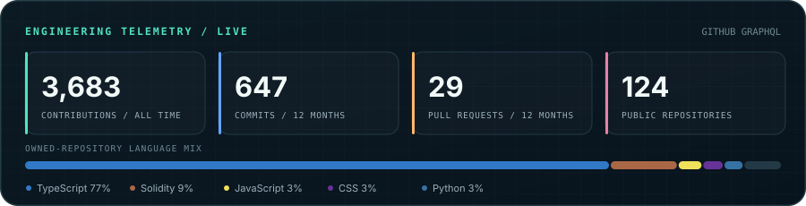
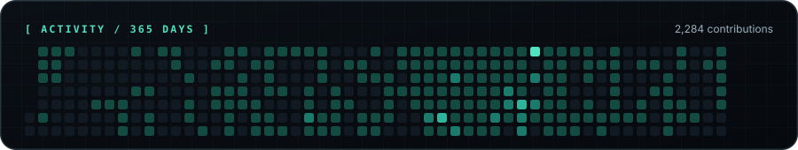

<!--
  GitHub profile for @dr-winner.
  Signature visuals are generated from scripts/ and committed locally so the
  profile stays fast, accessible, and independent of third-party card services.
-->

  

  
  
  
  

## [ 01 · About ]

**Application Security Engineer** focused on **web/API security and the security of AI/LLM applications**, with a production software engineering foundation in **React, Next.js, and TypeScript**.

I find what would break in production before an attacker does: manual penetration testing, secure code review and threat modeling across web apps, APIs and cloud services — then I engineer the fix, not just the report: production-ready patches, parameterized patterns and automated detection guardrails. My dedicated lab applies the **OWASP Top 10 for LLM Applications** to RAG pipelines and tool-using agents: indirect prompt injection, cross-tenant data leaks and excessive agency, tested deterministically in CI.

## [ 02 · Featured Security Work ]

- **[AI/LLM Agent Security Lab](https://github.com/dr-winner/portfolio)** — open-source engine in the portfolio repo. A deterministic security engine for RAG and tool-using agents, plus an OWASP LLM Top 10 regression suite that runs as the site's CI gate.  Live walkthrough on the [portfolio](https://duvorrichardwinner.me/work/llm-agent-security-lab).  
  AI Security · OWASP LLM Top 10 · Prompt Injection · Excessive Agency · RAG · CI

- **[Healthcare Web Application Pentest Case Study](https://github.com/dr-winner/healthcare-pentest-case-study)**  
  Full-scope penetration test report simulating hospital infrastructure. Documents a chained 6-phase kill-chain: SQL injection authentication bypass (`admin ' --`), CWE-204 username enumeration, weak PDF cryptographic cracking via `pdf2john`, document metadata forensics (`exiftool`), and payroll database exfiltration. Includes production PHP PDO prepared statement patches, AES-256 PDF encryption modules, and automated metadata scrubbing scripts.  
  Penetration Testing · OWASP Top 10 · WSTG v4.2 · SQLi · Cryptanalysis · PHP PDO · Python

- **[OSINT & Network Reconnaissance Assessment](https://github.com/dr-winner/osint-and-network-recon-assessment)**  
  Multi-vector open-source intelligence, external perimeter footprinting, and internal network enumeration. Covers WHOIS/DNS infrastructure profiling, GHDB query engineering, visual entity mapping with Maltego, passive subdomain discovery via theHarvester, and active subnet service profiling with Nmap/Zenmap.  
  OSINT · Reconnaissance · Nmap · Maltego · theHarvester · Attack Surface Management

- **[AWS Threat Detection & Response Lab](https://github.com/dr-winner/aws-threat-detection-lab)**  
  Detection-as-code engineering mapping AWS CloudTrail and GuardDuty findings through EventBridge rules to automated Python Lambda alerting handlers. Rules mapped to MITRE ATT&CK (root account usage, non-MFA console logins, CloudTrail tampering, IAM persistence, security group exposures) with automated SNS and Slack alerting.  
  Cloud Security · AWS · Detection-as-Code · EventBridge · Lambda · GuardDuty · Checkov

## [ 03 · Production Engineering Background ]

Leveraging full-stack experience to build and audit modern web architectures:

- **[Security Portfolio Platform](https://github.com/dr-winner/portfolio)**: Secure personal platform featuring per-request CSP nonces, strict response headers, typed content-as-data modules, and a tiny static-first footprint. **The repo powering this profile.**  Next.js · TypeScript · Tailwind CSS · Vercel
- **[CareerOS](https://github.com/dr-winner/careeros)**: Career operating system with an audited relational data model, strict input validation, and zero-downtime migration pipelines.  React · Next.js · TypeScript · Prisma · Neon PostgreSQL
- **[Hardened Flask Delivery](https://github.com/dr-winner/npontu-devops)**: Containerized microservice delivery with non-root runtime enforcement, automated health checks, GHCR publishing, and Azure deployment.  Flask · Docker · GitHub Actions · Azure Container Apps

## [ 04 · Core Security & Technical Competencies ]

- **Application Security (Web & API)** — manual penetration testing and secure code review against the OWASP Top 10 and API Security Top 10: authentication bypass, SQL injection, broken access control (IDOR/BOLA/BFLA), session attacks, cryptographic flaws, Burp Suite Pro.
- **AI/LLM Application Security** — OWASP Top 10 for LLM Applications, direct & indirect prompt injection, unsafe output handling, excessive agency, RAG cross-tenant leakage, LLM evaluation.
- **Cloud & Detection Engineering** — AWS (GuardDuty, CloudTrail, EventBridge, Lambda, IAM, S3 hardening), detection-as-code, Terraform, Checkov, MITRE ATT&CK.
- **Recon & OSINT** — passive subdomain harvesting, DNS zone profiling, Maltego link analysis, GHDB, theHarvester, Shodan, Nmap/Zenmap.
- **Languages & Frameworks** — TypeScript, JavaScript, Python, PHP, SQL, React, Next.js, Node.js, Tailwind CSS, Prisma ORM.

## [ 05 · Engineering Telemetry ]

  

  

Generated from the GitHub API by a scheduled <a href="./.github/workflows/stats.yml">GitHub Action</a>. Self-hosted SVGs keep the profile fast with no third-party card dependencies.

## [ 06 · Current Focus ]

- Security-testing AI/LLM features: RAG pipelines, agents and chat surfaces, against the OWASP LLM Top 10.
- Building deterministic security engines for LLM agents that gate releases inside CI.
- Writing production-grade remediation patches that fix root-cause weaknesses.

  <strong>▍Open to Application Security, Product Security & AI/LLM Security roles.</strong> 
  Accra, Ghana · GMT · <a href="https://duvorrichardwinner.me">duvorrichardwinner.me</a> · <a href="mailto:duvorrichardwinner@gmail.com">duvorrichardwinner@gmail.com</a>

