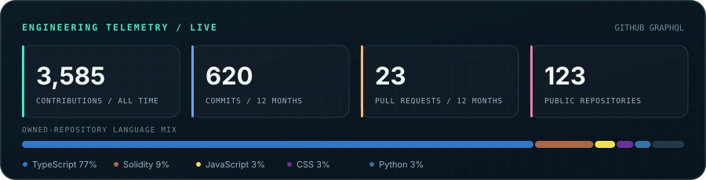
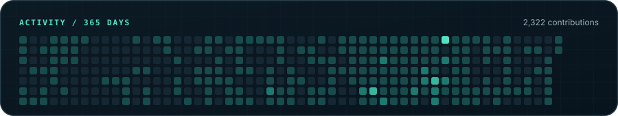

<!--
  GitHub profile for @dr-winner.
  Signature visuals are generated from scripts/ and committed locally so the
  profile stays fast, accessible, and independent of third-party card services.
-->

  

  
  
  
  

# Winner (dr-winner)

## About

**Web Application Penetration Tester & Application Security Engineer** with a production software engineering foundation in **React, Next.js, and TypeScript**. 

I bridge the gap between offensive security testing and hands-on software development: using a builder's intuition to identify architectural and logic flaws across web applications, APIs, and cloud services—then engineering concrete, production-ready code fixes, parameterized patterns, and automated detection guardrails.

---

## Featured Security Repositories & Assessments

- **[Healthcare Web Application Pentest Case Study](https://github.com/dr-winner/healthcare-pentest-case-study)**  
  Full-scope commercial-style penetration test and security audit report simulating hospital infrastructure. Documents a chained 6-phase kill-chain: SQL injection authentication bypass (`admin ' --`), CWE-204 username enumeration, weak PDF cryptographic cracking via `pdf2john`, document metadata forensics (`exiftool`), and payroll database exfiltration. Includes production PHP PDO prepared statement patches, AES-256 PDF encryption modules, and automated metadata scrubbing scripts.  
  Penetration Testing · OWASP Top 10 · WSTG v4.2 · SQLi · Cryptanalysis · PHP PDO · Python

- **[OSINT & Network Reconnaissance Assessment](https://github.com/dr-winner/osint-and-network-recon-assessment)**  
  Multi-vector open-source intelligence (OSINT), external perimeter footprinting, and internal network enumeration assessment. Covers WHOIS/DNS infrastructure profiling, Google Hacking Database (GHDB) query engineering, visual entity relationship mapping with Maltego Graph, passive subdomain discovery via theHarvester, and active subnet service profiling using Nmap/Zenmap.  
  OSINT · Reconnaissance · Network Scanning · Nmap · Maltego · theHarvester · Attack Surface Management

- **[AWS Threat Detection & Response Lab](https://github.com/dr-winner/aws-threat-detection-lab)**  
  Detection-as-code security engineering project mapping AWS CloudTrail and GuardDuty findings through Amazon EventBridge rules to automated Python Lambda alerting handlers. Rules mapped to MITRE ATT&CK tactics (root account usage, non-MFA console logins, CloudTrail tampering, IAM persistence, and security group exposures) with automated SNS email and Slack alerting.  
  Cloud Security · AWS · Detection-as-Code · EventBridge · Lambda · GuardDuty · MITRE ATT&CK · Checkov

---

## Production Engineering Background

Leveraging full-stack engineering experience to build and audit modern web architectures:

- **[Security Portfolio Platform](https://github.com/dr-winner/portfolio)** — Production personal platform featuring secure session management, rate-limited API routes, sanitized payload uploads, and real-time operational telemetry. Next.js · TypeScript · Tailwind CSS · PostgreSQL · Vercel
- **[CareerOS](https://github.com/dr-winner/careeros)** — High-performance career operating system with an audited relational data model, strict input validation, and zero-downtime database migration pipelines. React · Next.js · TypeScript · Prisma · Neon PostgreSQL
- **[Hardened Flask Delivery](https://github.com/dr-winner/npontu-devops)** — Containerized microservice delivery with non-root runtime enforcement, automated health checks, GHCR publishing, and Azure deployment. Flask · Docker · GitHub Actions · Azure Container Apps

---

## Core Security & Technical Competencies

- **Web Application Penetration Testing:** OWASP Top 10, API Security (REST/GraphQL), Authentication Bypass, SQL Injection, Broken Access Control (BAPI/BFLA), Cryptographic Flaws, Session Fixation, Burp Suite Pro.
- **Reconnaissance & OSINT:** Passive Subdomain Harvesting, DNS Zone Profiling, Maltego Visual Link Analysis, Google Hacking (GHDB), theHarvester, Shodan, Nmap, Zenmap.
- **Cloud & Detection Engineering:** AWS (GuardDuty, CloudTrail, EventBridge, Lambda, IAM, S3 Hardening), Detection-as-Code, Infrastructure as Code (Terraform), Static Analysis (Checkov, Ruff), MITRE ATT&CK Framework.
- **Languages & Frameworks:** TypeScript, JavaScript, Python, PHP, SQL, React, Next.js, Node.js, HTML5/CSS3, Tailwind CSS, Prisma ORM.

---

## Engineering Telemetry

  

  

Generated from the GitHub API by a scheduled <a href="./.github/workflows/stats.yml">GitHub Action</a>. Self-hosted SVGs ensure high availability without external card dependencies.

---

## Current Focus

- Executing in-depth web application penetration testing labs and vulnerability case studies.
- Engineering detection-as-code guardrails and automated security pipelines for modern cloud workloads.
- Writing production-grade remediation patches that address root-cause weaknesses at both the application and network layers.

---

  <strong>Open to Web Application Penetration Testing, AppSec, and Cloud Security roles.</strong> 
  Accra, Ghana · GMT · <a href="https://duvorrichardwinner.me/#contact">duvorrichardwinner.me</a> · <a href="mailto:duvorrichardwinner@gmail.com">duvorrichardwinner@gmail.com</a>

